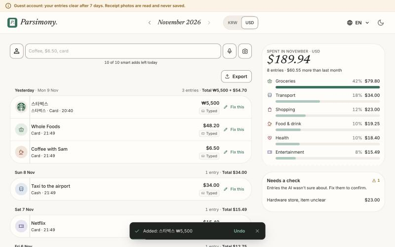
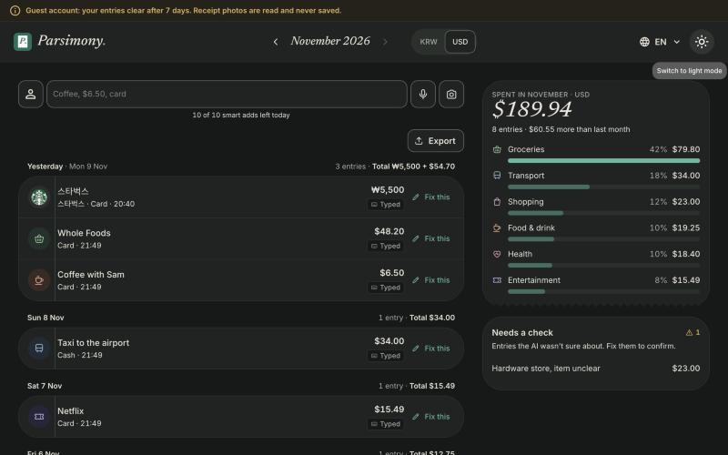

# Parsimony

An AI expense tracker. Type it, say it, or photograph a receipt, and a model turns it into one structured entry (date, amount, currency, category, payment method, merchant, items). The app is in English and Korean (Uzbek is also built in).

**Live demo:** https://parsimony.duckdns.org (press "Try it as a guest": sample data, no sign-up, deleted after 7 days)

| English | Korean |
|---|---|
|  |  |

| Typing a Korean sentence | Dark mode |
|---|---|
|  |  |

`어제 스타벅스 5500원 카드` becomes: merchant 스타벅스, ₩5,500, card, yesterday's date.

## What it does

- One flow: input -> JSON -> list. A monthly total, a category breakdown, an entry list, and a "Fix this" button for anything the AI got wrong.
- Entries the AI was unsure about land in a "Needs a check" box.
- Multi-currency (KRW / USD / UZS), shown per currency, never converted.
- Guest accounts with daily AI-call caps, rate limits, file size and type checks.
- Receipt photos are read and never stored.

## How it works

```
React (Vite, TanStack Query, MUI)  ->  FastAPI  ->  parser service  ->  Gemini (JSON schema output)
                                          |
                                      Postgres 16
```

`routers/` (HTTP only) -> `services/` (logic) -> `models/` (tables). AI sits behind a Protocol in `backend/app/ai/base.py`, so services never import a concrete model class. Text, voice and receipt photo all end in the same text-to-JSON parser. Deployed with Docker Compose and Nginx behind HTTPS.

## Fine-tuning experiment (`ml/`)

A self-study project: could a small open model do the parsing instead of the API?
I fine-tuned Qwen2.5-1.5B with LoRA on a free Colab T4 and scored it on **100 hand-labeled test cases that were never used for training** (34 English, 33 Korean, 33 Uzbek).

| Entries fully right (all fields) | Score |
|---|---|
| Gemini API (the app's real prompt) | **85 / 100** |
| Qwen2.5-1.5B, untuned | 0 / 100 |
| LoRA round 1 (template data) | 45 / 100 |
| LoRA round 2 (Gemini-worded data) | 67 / 100 |
| LoRA round 3 (date codes resolved in code, mixed-currency items) | **73 / 100** |

The app still uses Gemini, because it is better on this test. The point was to learn the whole loop: build a test set first, get a baseline, find why round 1 failed (the model memorized my templates), fix the data, and measure again.

Be careful with these numbers: 100 cases means a few points is noise; training data is mostly synthetic; Korean and Uzbek wording has had no native review; the date step moved into plain code in round 3, so part of that gain is a design choice, not model skill. Full table, what each round changed, known weaknesses and caveats: [`ml/RESULTS.md`](ml/RESULTS.md).

## Run locally

```bash
cp .env.example .env        # then add your own GEMINI_API_KEY
docker compose up --build
curl http://localhost:8000/api/health   # -> {"status":"ok"}
```

Backend tests: `docker compose exec backend pytest -q` · Frontend: see `frontend/package.json` · End-to-end: Playwright smoke tests run in CI.

## Layout

`backend/` FastAPI API · `frontend/` React app · `ml/` data, training notebook, scorer, results · `docs/` design notes, decisions, limitations, deploy · `nginx/`, `deploy/` production setup

Never commit `.env`. Use made-up receipts only; the app is a portfolio demo and should not receive real personal data.
