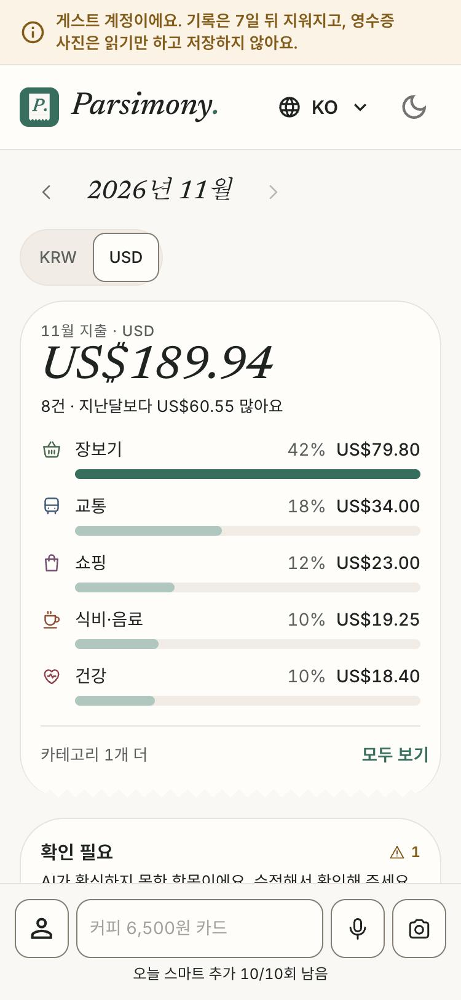
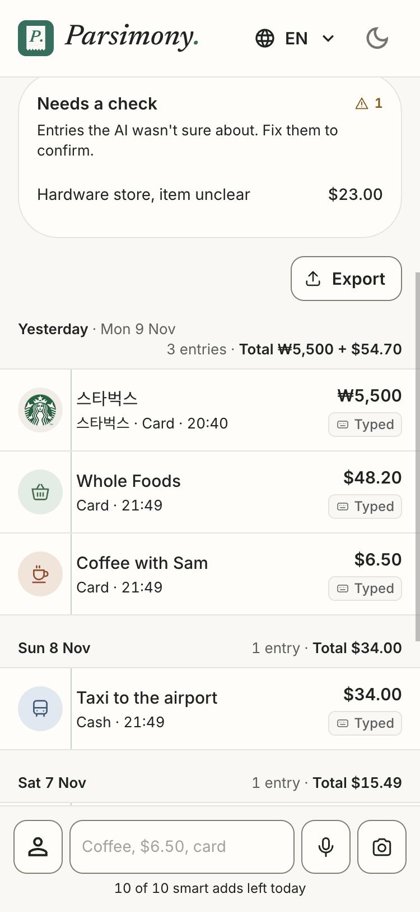
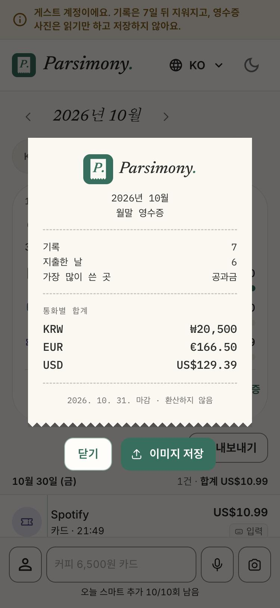

# Parsimony

**AI expense tracker.** Type a line, say it, or photograph a receipt, and a language model turns it into one structured, editable entry. English, Korean and Uzbek. Installable PWA, light and dark themes, built for phones first.

**Live:** https://parsimony.duckdns.org (use "Try it as a guest": sample data, no sign-up, wiped after 7 days)

| English | Korean |
|---|---|
|  |  |

<p>
  
  
  
</p>

`어제 스타벅스 5500원 카드` becomes: merchant 스타벅스, ₩5,500, card, yesterday's date, category food & drink, with a logo.

## Highlights

- **One flow, three inputs.** Text, voice and receipt photo all end in the same text-to-JSON parser, which returns a schema-constrained answer (date, amount, currency, category, payment method, merchant, items, confidence).
- **Built for imperfect AI.** Low-confidence entries go to a "Needs a check" box, every entry has a one-tap "Fix this", voice is transcribed first and confirmed before saving, and a manual form works even when the AI fails or the daily limit is used up.
- **Cost and abuse controls.** Per-account and global daily AI-call caps, rate limits on auth, file size and type checks (magic bytes, not file names), photos and audio held in memory and never stored.
- **Multi-currency without guessing.** KRW / USD / EUR / UZS are totalled per currency, never converted. A month-end receipt (saveable as an image) closes each month.
- **Phone-quality UX.** Swipe to delete with an undo window, optimistic updates, reduced-motion support, installable PWA.
- **Evaluated, not assumed.** The parser is scored on a hand-labeled test set, and a fine-tuned small model was compared against the API (see below).

## Architecture

```
React 18 + Vite + TypeScript (TanStack Router/Query, MUI, Recharts)
        |
     FastAPI  ->  routers (HTTP only) -> services (logic) -> models (SQLAlchemy 2) -> Postgres 16
        |
   AI adapters behind Protocols (ai/base.py) -> Gemini: text, receipt vision, voice transcription
```

Services never import a concrete AI class, so the model can be swapped (this is how the fine-tuned model was benchmarked). Deployed with Docker Compose and Nginx over HTTPS; Alembic migrations; CI runs lint, unit tests and Playwright end-to-end tests.

**Tests:** 152 backend tests (pytest), 100+ frontend unit tests (Vitest), Playwright smoke tests in CI.

## Model evaluation: API vs fine-tuned small model (`ml/`)

Question: can a small open model replace the API for this task? I built a 100-case hand-labeled test set (34 English, 33 Korean, 33 Uzbek), froze the labels, and scored every model on it. A case counts only if **every field** is right.

| Model | Fully right (of 100) |
|---|---|
| Gemini API, the app's production prompt | **85** |
| Qwen2.5-1.5B, untuned | 0 |
| + LoRA, round 1 (template data) | 45 |
| + LoRA, round 2 (Gemini-worded, code-labeled data) | 67 |
| + LoRA, round 3 (date codes resolved in code, mixed-currency items) | **73** |

LoRA r=16 on all attention and MLP layers, 2 epochs, a free Colab T4, ~25 minutes per run. The jump from 45 to 67 came from diagnosing why round 1 failed (the model memorized my templates) and rebuilding the data so labels are decided in code and a model only writes the wording. Round 3 moved date arithmetic out of the model into plain code, a design choice rather than extra model skill.

**Decision:** production stays on Gemini, because it is better on this test (85 vs 73). The experiment gives a measured fallback and a repeatable evaluation harness.

Test set is 100 cases (a few points is noise) and the training data is mostly synthetic. Full table, per-field breakdown and caveats: [`ml/RESULTS.md`](ml/RESULTS.md).

## Run locally

```bash
cp .env.example .env        # add your own GEMINI_API_KEY
docker compose up --build
curl http://localhost:8000/api/health   # -> {"status":"ok"}
```

Tests: `docker compose exec backend pytest -q`. Never commit `.env`. Use made-up receipts only; this is a demo and should not receive real personal data.

## Repository

`backend/` FastAPI API · `frontend/` React app · `ml/` test set, data generators, training notebook, scorer, results · `docs/` design notes, decisions log, honest limitations, deploy guide · `nginx/`, `deploy/` production setup
